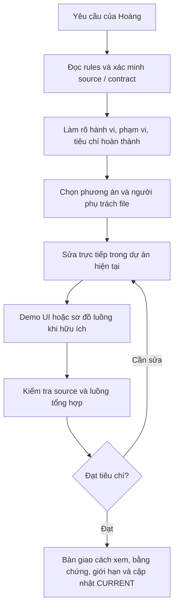

# Workflow chung cho manu

Mặc định: **đọc hướng dẫn → cân nhắc ba cách → tự chọn → sửa trực tiếp source → kiểm tra → cập nhật note ngắn**. Không cần bản sao, đóng gói hoặc duyệt từng bước. Chỉ cấm lệnh Git; các lệnh khác tự chọn phục vụ công việc.

Hướng dẫn kỹ thuật trong từng source vẫn giữ nguyên. Quy tắc lâu dài nằm ở `../AGENTS.md`; tài liệu tham khảo chỉ được áp dụng có chọn lọc theo yêu cầu hiện tại.

## Quy tắc bắt buộc về code và trao đổi

- Trước khi sửa frontend ứng dụng dùng MUI/sevago-library, đọc và áp dụng [manufacturing-execution-admin/AGENTS.md](../manufacturing-execution-admin/AGENTS.md) cùng hướng dẫn của source đang làm. Đây là nguồn quy tắc kỹ thuật chung; không chép lại toàn bộ sang các file khác. Backend và UI library giữ contract, stack và quy tắc riêng.
- Viết code ngắn, thẳng theo pattern hiện có: dùng component/helper chung, giữ data theo contract, không thêm abstraction, fallback, normalize, map/reduce hay state trung gian khi không cần. Page/part chính chỉ điều phối; tách hook, bảng và popup khi flow phức tạp, đồng thời bỏ logic trùng/thừa.
- Chỉ sửa phần phục vụ yêu cầu; không tự mở rộng thành refactor, demo hoặc cấu hình ngoài mục tiêu. Tự quyết các lựa chọn triển khai thông thường trong phạm vi đã giao.
- Giữ nguyên import hiện có, chỉ thêm/xóa import cần cho code đang sửa. Không tự sắp xếp import hoặc chạy format/auto-fix trình bày; người dùng tự xử lý và chạy `npm run format`. Xem [quy tắc import và format](../manufacturing-execution-admin/AGENTS.md#7-import-và-format).
- Trao đổi bằng tiếng Việt, ngắn và trực tiếp. Cập nhật tiến độ chỉ nêu phát hiện hoặc thay đổi có ý nghĩa; không kể lại từng thao tác, lặp kế hoạch hay giải thích dài khi người dùng không yêu cầu.
- Bàn giao ưu tiên ba ý: đã sửa gì, kiểm tra đạt/lỗi/chưa chạy, phần còn vướng hoặc bước cần làm. Chỉ kèm file/demo/lệnh khi giúp người dùng kiểm chứng; phân biệt rõ source đã sửa với ứng dụng đã nhận bản sửa.
- Các quy tắc này là mặc định cho những lần làm việc sau; chủ động đọc và áp dụng, không chờ người dùng nhắc lại. Quyết định lâu dài ghi trong hướng dẫn, không chỉ lưu ở `CURRENT.md`.

## Từ yêu cầu đến kết quả có thể xem



Với task phức tạp, trình bày ngắn: “Người dùng làm gì → hệ thống xử lý gì → kết quả nhìn thấy → điều kiện đạt”. Nêu giả định có ảnh hưởng; chỉ hỏi khi thiếu quyết định nghiệp vụ quan trọng. Với UI, ưu tiên demo thao tác được trong màn hình dự án, giữ component/pattern hiện có và ghi rõ dữ liệu mẫu/phần chưa nối API. Với backend/library, dùng sơ đồ xử lý hoặc ví dụ input/output phù hợp, không ép làm giao diện.

Khi bàn giao, cung cấp đường dẫn màn hình/file, lệnh chạy đã xác minh, các bước thao tác và kết quả mong đợi. Ghi riêng kiểm tra đã đạt, đã lỗi, chưa chạy cùng lý do/ảnh hưởng. Demo dữ liệu mẫu không thay kiểm tra tích hợp thật. Khi chưa có task cụ thể, chỉ làm rõ cách vận hành; không tự xây tính năng minh họa ngoài phạm vi.

Một phiên thực hiện phân tích, triển khai và review tuần tự. Khi người dùng mở ba phiên, trưởng nhóm giao mục tiêu, phạm vi file, contract, phụ thuộc, tiêu chí và cách kiểm tra; người triển khai sửa; reviewer kiểm chứng và báo lỗi cho người sở hữu file. Trưởng nhóm kiểm tra source tổng hợp trước khi kết luận. Dùng trao đổi và note hiện có, không cần thêm hệ thống điều phối hoặc bản sao.

## Dashboard local

Nhấp đúp `codex-workflow/Open-Dashboard.cmd` để mở. Hoặc chạy từ root `manu` (Python có sẵn, không cần cài thêm package):

```powershell
powershell -NoProfile -ExecutionPolicy Bypass -File codex-workflow/Open-Dashboard.ps1
```

Dashboard: **http://127.0.0.1:19329**. Script dùng lại server đang chạy đúng workspace hoặc khởi động server ẩn rồi mở trình duyệt. Không tự khởi động cùng Windows. Muốn chạy foreground: `python -B codex-workflow/dashboard.py serve`; dừng bằng Ctrl+C. Với server ẩn, dùng `powershell -NoProfile -ExecutionPolicy Bypass -File codex-workflow/Stop-Dashboard.ps1`. Hai script hỗ trợ `-Port` nếu cổng mặc định bận.

Giao diện chỉ đọc: tự tải lại 3 giây, hiển thị nhiệm vụ, tiêu chí, ba vai trò, file có thể mở xem, PASS/FAIL/NOT_RUN, demo, 30 mốc gần nhất và nội dung CURRENT.md. “Đã kết nối local” là kết nối tới dashboard, không xác nhận các agent đang chạy. Báo cáo đang làm quá 15 phút chưa cập nhật được đánh dấu cũ. Mỗi task mới thay dữ liệu task trước, không tạo hồ sơ lịch sử riêng.

Trưởng nhóm khởi tạo task mới với mã duy nhất; các phiên cùng task dùng đúng mã này. **Đổi mã sẽ xóa báo cáo vai trò cũ**; giữ mã nếu tiếp tục công việc hiện tại. `status` để đọc trước khi sửa:

```powershell
python -B codex-workflow/dashboard.py status
python -B codex-workflow/dashboard.py task --id "task-moi" --title "Mục tiêu được giao" --goal "Hành vi mong muốn" --criterion "Điều kiện quan sát được"
python -B codex-workflow/dashboard.py update --task-id "task-moi" --role implement --status working --phase implementation --action "Đang sửa hook theo contract đã xác minh" --file "project/src/example.ts" --next "Kiểm tra trường hợp API lỗi" --check "NOT_RUN|Chưa chạy kiểm tra vì đang sửa"
python -B codex-workflow/dashboard.py update --task-id "task-moi" --role implement --status done --phase handoff --action "Đã sửa và kiểm tra phần được giao" --check "PASS|Lệnh kiểm tra đã chạy: kết quả thực tế" --next "Chuyển review"
```

Các lệnh minh họa trên chỉ chạy khi có task/file thật, không dùng để tạo tiến độ giả. Vai trò: `lead`, `implement`, `review`. Trạng thái: `planned`, `working`, `review`, `blocked`, `done`, `idle`. Giai đoạn: `analysis`, `implementation`, `verification`, `handoff`. Trưởng nhóm dùng lại lệnh `task` với cùng mã, tiêu đề/mục tiêu và `--status done` để kết thúc nhiệm vụ tổng sau kiểm tra. Trạng thái vai trò done không tự kết thúc task tổng.

`--file`, `--check`, `--artifact` được lặp; khi truyền sẽ thay danh sách tương ứng, khi bỏ qua sẽ giữ lại danh sách cũ. `--artifact "http://127.0.0.1:12021/..."` cho demo thực tế; `--model` chỉ ghi model đã biết (không đổi model); `--blocker` ghi nguyên nhân khi bị chặn. Cập nhật trạng thái khác blocked sẽ bỏ blocker cũ nếu không truyền lại. File dùng đường dẫn tương đối từ manu; chỉ file khai báo và hướng dẫn chung được mở trên giao diện, tối đa 1 MB/file UTF-8.

Các phiên cập nhật báo cáo qua CLI có khóa ghi; task ID ngăn kết quả đến muộn ghi vào task mới. File đang có vai trò khác nhận sửa sẽ bị báo xung đột; reviewer được đọc cùng file. Dashboard không tự kết nối ba tài khoản, không tự gọi model/API, không điều khiển terminal và không thống kê token khi không có nguồn đo. Người dùng tiếp tục xem thao tác chi tiết ở phiên Codex tương ứng. Note tiếp nhận vẫn chỉ dùng CURRENT.md; dashboard-state.json là dữ liệu hiển thị, không thay note.

Kiểm tra dashboard và note: `python -B -m unittest discover -s codex-workflow/tests -v`. Kiểm tra browser (dùng Playwright đã cài ở admin): `node codex-workflow/tests/test_dashboard_browser.cjs`.

## Tiếp nhận và lưu tiến độ

Đọc `../AGENTS.md`, `CURRENT.md`, sau đó AGENTS.md của source liên quan. Note hiện tại là một bản tóm tắt được thay thế, không phải log nối dài. Có thể sửa note trực tiếp hoặc dùng CLI Python 3.11+:

```powershell
python -B codex-workflow/workflow.py projects
python -B codex-workflow/workflow.py resume
python -B codex-workflow/workflow.py note --task "Mục tiêu hiện tại" --files "project/src/file.ts" --done "Đã sửa phần A" --check "Lệnh kiểm tra: đạt/lỗi/chưa chạy" --next "Mở file X, xử lý trường hợp Y"
```

`--done`, `--check`, `--files`, `--blocker` được lặp lại. Mỗi lần `note` **thay toàn bộ note**: đưa lại những ý cũ còn cần thiết. Khi xong dùng `--status done`; đang vướng dùng `--status blocked`. Mặc định `in_progress`. `--task` và `--next` bắt buộc để phiên sau biết làm gì.

CLI chỉ nhận diện project và lưu/đọc note, không phải điều kiện bắt buộc trước khi code và không chạy lệnh thay agent. Root mặc định là manu, xác định từ vị trí script; `--root` hỗ trợ workspace khác/kiểm thử. Không tạo `state/`, bản sao hoặc hồ sơ task. Project mới có manifest/solution hoặc AGENTS.md được nhận diện tự động.

## Giữ ngắn và đúng

- Note: mục tiêu; file; đã làm/quyết định cần giữ; kiểm tra; vướng; bước kế tiếp. Khoảng 10–25 dòng là đủ cho task thông thường.
- Cập nhật ở mốc quan trọng và trước khi ngắt/chuyển phiên; khi quay lại đối chiếu với source thật. Không ghi “đạt” cho kiểm tra chưa chạy.
- Không chép log dài, secret hoặc lịch sử hội thoại. Không cần thêm file báo cáo, template hay lessons cho mỗi task.
- Nếu có ba phiên: trưởng nhóm điều phối, member 1 sửa, member 2 review. Không sửa cùng file đồng thời. Note chung mặc định cho một task; CLI có khóa ghi nhưng không tự hòa giải nội dung từ nhiều phiên.
- Hướng dẫn riêng của source admin/library vẫn áp dụng. Backend theo stack/pattern thực tế của nó. Không cần hỏi lại quyền sửa source đã được giao.

Kiểm tra công cụ: `python -B -m unittest discover -s codex-workflow/tests -v`. Các test dùng thư mục tạm; kết quả này không thay lint/build/test ứng dụng.
